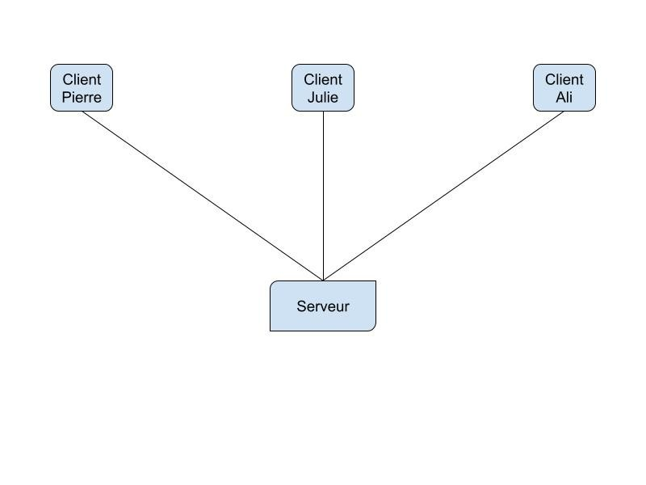
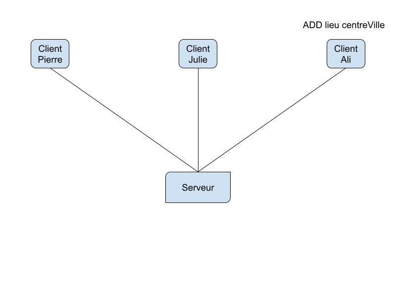
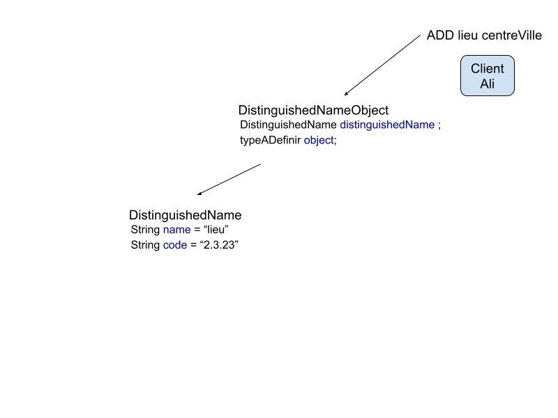
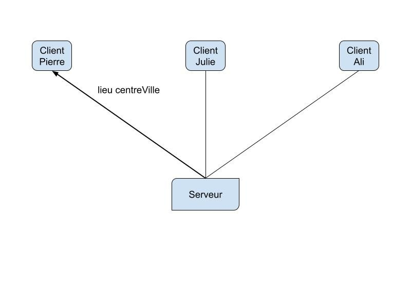

# Projet 2026 - Sujet et Dépôt

**Projet de Modélisation et Programmation Orientée Objet A rendre avant le mercredi 9 décembre 2026 à 16h00 sur la plateforme ENT (lien du dépôt est à la suite de ce sujet)**


Vous réaliserez le projet en conditions d'examen chez vous, c'est à dire que vous aurez accès à internet uniquement pour consulter la javadoc d'Oracle :

https://docs.oracle.com/javase/8/docs/api/allclasses-noframe.html

Ce projet est à réaliser en **binôme d'étudiants issus du même groupe** et ne doit comporter aucun code provenant de quelconque sources extérieures (internet, autre groupe d'étudiants, etc.). Aucun manquement au caractère personnel du travail en groupe qui soit plus ou moins flagrant ou manifeste ne sera toléré.

Pensez bien en amont à la structure de votre projet. Ceci vous permettra, au besoin, d’ajouter les classes et autres éléments nécessaires et non explicitement demandés ... Structurez votre code en packages dédiés et votre code doit être commenté (sans abus permettant de générer la javadoc) et doit contenir les exceptions adéquates ainsi que l’écriture normalisée des variables et autres éléments composants votre code.

Vous présenterez en **binôme** votre projet lors de votre séance d'évaluation prévue le 10 décembre. La **présence** des deux étudiants formant le binôme est **obligatoire**.

## Objectifs

L’objectif de ce projet est de réaliser une application permettant d’échanger des informations codées via le réseau. Ces communications seront réalisées entre plusieurs clients et un serveur centralisé comme illustré dans la figure ci-dessous.



Les informations échangées auront la forme d’objet unique contenant un nom et une information qui pourra prendre différentes formes (Chaîne de caractères, fichier textuel, etc.). Ces objets seront transférés aux utilisateurs disposant du code associé à l’objet ainsi que de l’identité du propriétaire de cet objet. L’utilisateur (client) aura la possibilité de "requêter" le serveur pour se connecter, envoyer/récupérer des objets, etc.

## Composition des objets

Les objets que l’on nommera “DistinguishedNameObject” ou DNO seront composés d’un “DistinguishedName” ou DN (contenant lui-même un nom et un code), et d’une information que l’on appellera par la suite “objet” (message, fichier, etc.). Chaque type d’objet (message, fichier, etc.) disposera d’un ensemble de services que toutes les classes seront contraintes d’implémenter, à savoir :

```java
public void display();

public Object getObject();

public void setObject(Object o);

public String getFrom();

public void setFrom(String from);

public String getDets();

public void setDets(String dest);
```

L'accès (création et récupération) d'un DNO se fera via une classe utilitaire “DistinguishedNameObjectFactory” (DNOF) permettant la création d’un DNO de n’importe quel type et disposant de n’importe quel algorithme d’encodage. On ne pourra créer qu'un seul DNOF.

Pour finaliser ce package, vous ajoutez une classe “DistinguishedNameObjectList” deviant de ArrayList permettant à chaque client de disposer de l’ensemble des DNO créés et de pouvoir les transférer au serveur de manière unifiée.

## Encodage

Tous les DNO créés contiennent un nom et un code (via le DN) issu de ce nom permettant d'anonymiser l’identité de l’objet contenu dans le DNO. Cet encodage sera réalisé à partir d’une classe (une par type d’encodage et au moins deux pour ce projet) qui respectera un ensemble de service communs à tous les algorithmes d’encodage :

```java
public String getCodeFromName(String name);

public String getNameFromCode(String code);
```

## Interactions codées client/serveur

Tous ces DNO contenus dans la liste de chaque client sont anonymisés. Un client aura la possibilité (commande entre parenthèses): 

- de se connecter au serveur, (**CONNECT**)

- d’ajouter de nouveaux DNO de type chaîne de caractères à sa liste, (**ADD**)

- d’ajouter de nouveaux DNO de type fichier à sa liste, (**FILE**)

- de supprimer des DNO, (**DEL**)

- d’envoyer sa liste au serveur, de la modifier puis de l’envoyer à nouveau, (**LIST**)

- d’afficher l’ensemble des listes du serveur (pour les tests uniquement), (**DISPLAY**)

- de récupérer un objet contenu dans un DNO d’un autre client, (**GET**)

- d’envoyer un message privé (pour le code par exemple) à un autre client, (**PRIVATE**)

- etc. (à vous de voir si d’**autres commandes** seraient utiles …)

- …

Toutes ces tâches seront à réaliser à l’aide de la sérialisation d’objet et de sous-processus dédié. Il sera notamment attendu la possibilité d’envoyer des fichiers et de pouvoir les sauvegarder après réception. Le serveur ne contiendra jamais les objets (DNO) mais uniquement le code et son propriétaire. Pour transférer un objet d'un client à l'autre, le serveur se positionnera comme intermédiaire pour faire transiter cet objet entre les deux clients.

|Commande|Figure|
|:-:|:-:|
|Ali tape la commande permettant d’ajouter une nouvelle entrée dans sa liste.||
|L’application ajoute un nouveau DNO de type chaîne de caractères ayant un DN avec comme nom “lieu” et comme code “2.3.23” issu de l’algorithme d’encodage choisi. L’objet du DNO est une chaîne de caractère “centreVille”. Son type est à définir et doit être en mesure de permettre de couvrir les données textuelles (messages) et les fichiers.||
|Pierre demande au serveur de lui retourner l’objet associé au code "2.3.23" en lui indiquant pour des raisons de sécurité le nom du propriétaire du DNO ("Ali").||
|L’application retourne à Pierre le DNO associé décodé. Il en sera de même pour les fichiers. Le propriétaire ainsi que la destination des objets transmis pourront être contenus dans l’objet.||

## Travail attendu

Vous devrez proposer une modélisation adaptée et respectant l’ensemble des contraintes ainsi que des scénarios d’utilisation permettant de couvrir l’ensemble des cas d’utilisation. Un seul rendu sera à fournir par binôme au format zip contenant l’ensemble des sources à la suite de la présentation des projets et une modélisation de votre programme (PDF).

### Il est notamment attendu de votre application que :

- Un serveur centralisé permettant de vérifier l’identité du propriétaire avant transmission de l’objet (chaîne de caractère, fichier, etc.)

- Toutes les classes (DN et DNO) permettant la gestion des informations transmises ne pourront être accessibles en dehors du package associé.

- Au moins deux fonction lambda ou référence de méthode et au moins une interface fonctionnelle.

- Les objets contenus dans les DNO devront respecter l’ensemble des services énoncés plus haut.

- Au moins deux algorithmes d’encodage devront être proposés et fournir les services indiqués plus haut.

- Chaque client devra “écouter” en permanence les messages reçus de la part du serveur et agir en conséquence.

- Vous implémentiez l'ensemble des interactions mentionnées plus haut.

- Les exceptions nécessaires respectant les conventions vues en cours et TP.

- La documentation (Javadoc)

## Critères d'évaluation

- L'évaluation prendra très largement en compte l'utilisation de l'encapsulation, des interfaces, de l'héritage et de la redéfinition de méthodes. Tout projet ne respectant pas ces contraintes sera durement pénalisé.

- Il sera apporté un soin tout particulier à la lisibilité et à la clarté des programmes. Les programmes devront, comme vu lors des TPs, comporter des commentaires permettant de produire une documentation avec javadoc.

- Toutes les fonctionnalités demandées devront être implémentées. Les questions seront posées indistinctement à n'importe quel étudiant formant le binôme et celui-ci doit être en mesure de répondre quelque soit la partie que celui-ci aura développé de préférence.

- Le code doit être dispatché dans des répertoires (packages) dédiés permettant de maintenir une clarté dans votre code. Celui-ci doit également être commenté à l’aide de la javadoc sans excès. L’ensemble des exceptions susceptibles d’être levées doivent être gérées dans votre code via une arborescence tel que vu lors des TPs. Ce travail est à réaliser en binôme uniquement.

- Toute fonction supplémentaire (commande, etc.) sera considérée lors de l'évaluation, mais gardez à l'esprit que votre projet doit avant tout être fonctionnel et satisfaire toutes les attentes décrites dans ce sujet avant d'entamer d'autres fonctionnalités.

- La **note** dévolue à cette évaluation tiendra compte des deux volets : **Présentation** et qualité des échanges (réponses et organisation, les deux étudiants formant le binôme doivent être en mesure de répondre à toutes les questions posées) **ainsi** que les **sources** rendus au format zip (un par binôme).

## Annexes

### Dépôt des sources de votre projet avant le jeudi 9 décembre 2026 à 20h00 
> Vous composerez une archive **au format zip uniquement** contenant votre modélisation ainsi que les packages  avec les fichiers .java (et non pas les fichiers .class) de votre projet et le déposerez avant le jeudi 9 décembre 2026 à 20h.
>
> Un rendu par binôme avec le nom des deux étudiants dans le titre de l'archive zip.     
>
>M. Morchid

### Demo vidéo

<video width="100%" height="100%" controls>
  <source src="Demo_Serveur_Code.mov" type="video/mp4">
</video>

> Cette demo est fournie à titre indicatif, et votre application peut différer de celle-ci tant qu'elle respecte toutes les consignes énoncées dans le sujet.
> 
> **Cas d'utilisation :**
> 
> Trois clients (a,b et c) se connectent au serveur. Le client A crée un objet de type chaîne de caractères au nom de "a" qui est codé 1. Le client C demande en privé le code de l'objet qu'il doit récupérer. Le client A le lui transmet (pas directement du premier coup) puis le client C le récupère. Suit une démo pour le cas du fichier.
> 
> M. Morchid

### Exemple

> [Exemple Encodage](CaesarEncoderDecoder.java) JAVA

<time datetime="2026-11-11T12:27:00+01:00">Nov 11, 2026</time>


