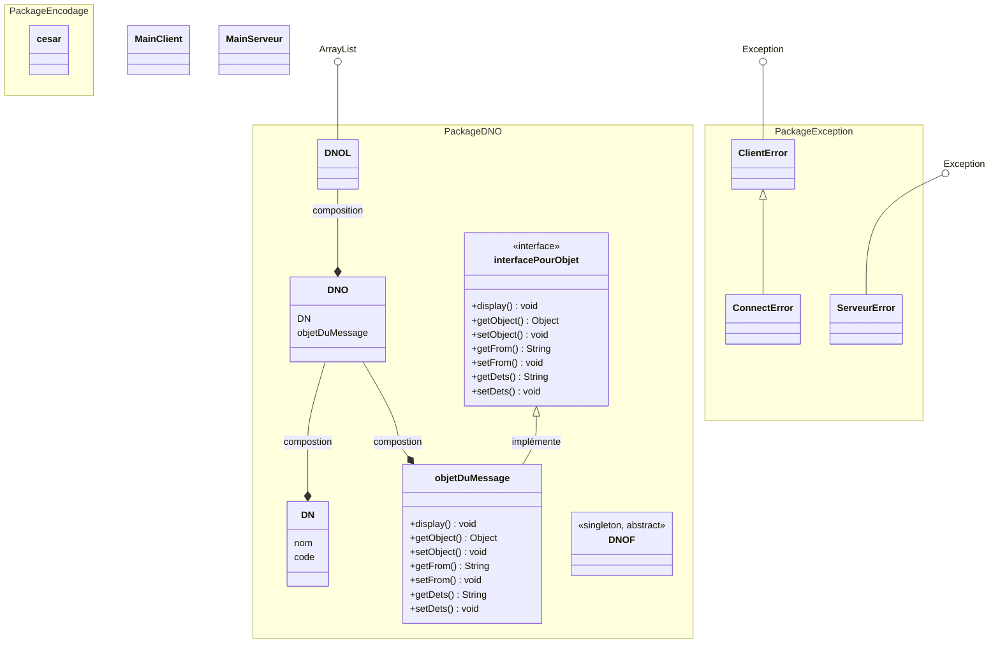

- javaDoc en fr
- génération du code à partir de quoi ?
- https://mermaid.js.org/syntax/classDiagram.html
- on fait des threads pour le serveur
- le code sert à chiffrer le nom de l'objet pour pas qu'il soit en clair dans les transcriptions
- si on doit transmettre un string, il faut créer un objet contenant un string et implémenter les méthodes

