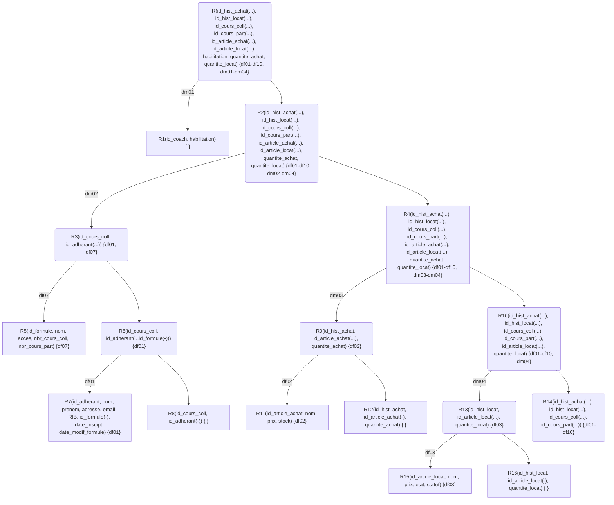
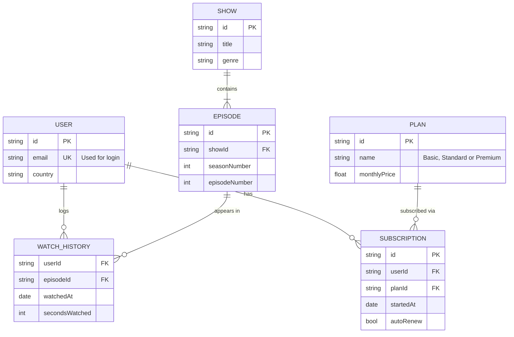

# Modélisation :

Bonjour, voici la modélisation de la base de donnée pour votre entreprise **Elan&Spa**. J'espère que mes propositions seront répondre à vos demandes et je reste à votre disposition pour effectuer des modifications sur ce cahier des charges.

## Entitées / attributs isolés:
- Adhérant |
- Article_achat |
- Article_location |
- Coach |
- Cours_collectif |
- Cours_particulier |
- Formule |
- Historique_achat |
- Historique_location |
- habilitation
- quantite_achat
- quantite_locat
- Salle |

*penser à rajouter quelque chose pour le login*

## Squelette :
```
    Historique_achat | Adhérant | Formule |

    Historique_location | Adhérant | Formule |

    Cours_collectif | Salle |
                    | Coach |
    
    Cours_particulier | Salle |
                     | Coach |
                     | Adhérant | Formule |
    
    Article_achat |

    Article_location |

    habilitation
```

## Dépendances Fonctionnelles:

- **df01:** id_adherant -> nom, prenom, adresse, email, RIB, id_formule, date_inscipt, date_modif_formule

- **df02:** id_article_achat -> nom, prix, stock

- **df03:** id_article_locat -> nom, prix, etat, statut

- **df04:** id_coach -> nom, prenom

- **df05:** id_cours_coll -> type_cours, date, creneau, id_coach, id_salle, capacite

- **df06:** id_cours_part -> type_cours, date, creneau, id_coach, id_salle, id_adherant

- **df07:** id_formule -> nom, acces, nbr_cours_coll, nbr_cours_part

- **df08:** id_hist_achat -> id_adherant, date

- **df09:** id_hist_locat -> id_adherant, date_location

- **df10:** id_salle -> nom, type, capacite

## Dépendances Multivaluées:
    
- **dm01:** id_coach ->-> habilitation

- **dm02** id_cours_coll ->-> id_adherant(...)

- **dm03** id_hist_achat ->-> id_article_achat(...), quantite_achat

- **dm04** id_hist_locat ->-> id_article_locat(...), quantite_locat

<div style="page-break-after: always;"></div>

## Arbre de décomposition :

*L'arbre ci dessous n'est pas encore fini... et surtout doit être refait...*



<div style="page-break-after: always;"></div>

## Schéma des tables :

*Le schéma ci dessous est là en tant que placeholder*

