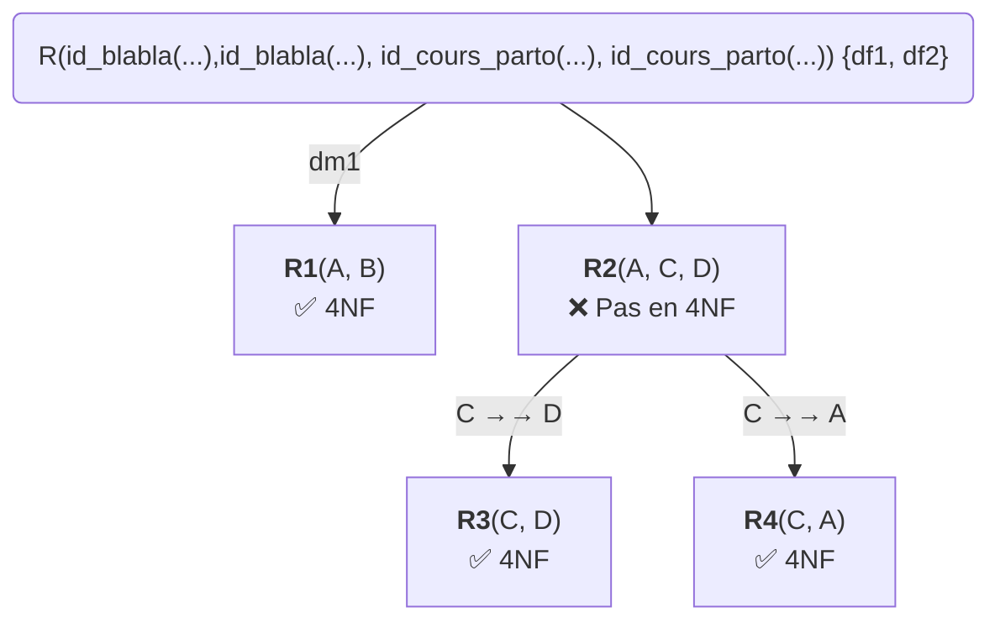
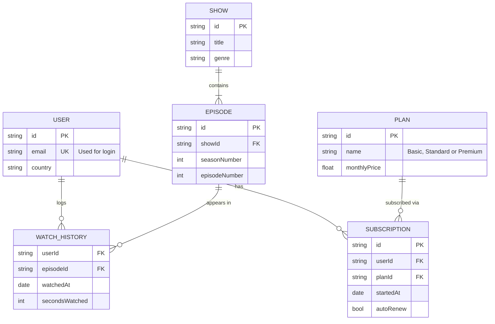

# Modélisation :

Bonjour, voici la modélisation de la base de donnée pour votre entreprise `Elan&Spa`. J'espère que mes propositions seront répondre à vos demandes et je reste à votre disposition pour effectuer des modifications sur ce cahier des charges.

## Entitées :
- Achat
- Article
- Client
- Coach
- Cours_collectif
- Cours_particulier
- Formule
- Historique
- Pret
- Salle

## Squelette :

    Cours_collectif | Coach |
                    | Salle |

    Cours_particulier | Coach  |
                      | Salle  |
                      | Client | Formule |

    Historique |

    Achat |

    Pret |

    Article |

## Dépendances Fonctionnelles:
    
    df1: ...
    

## Dépendances Multivaluées:
    
    dm1: ...

## Arbre de décomposition :

*L'arbre ci dessous est là en tant que placeholder et n'est pas fini*

## Schéma des tables :

*Le schéma ci dessous est là en tant que placeholder et n'est pas fini*

