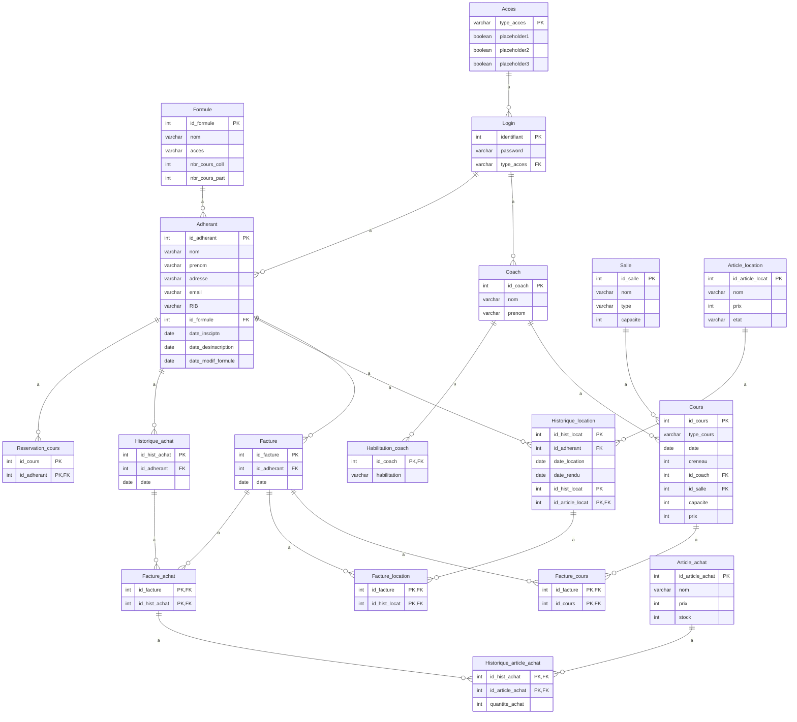

# Modélisation :

Bonjour, voici la modélisation de la base de donnée pour votre entreprise **Elan&Spa**. J'espère que mes propositions seront répondre à vos demandes et je reste à votre disposition pour effectuer des modifications sur ce cahier des charges.

## Entitées / attributs isolés :
- Accès |
- Adhérant |
- Article_achat |
- Article_location |
- Coach |
- Cours |
- Facture | 
- Formule |
- habilitation
- Historique_achat |
- Historique_location |
- Login |
- quantite_achat
- Salle |

## Squelette :
```
    Historique_achat | Adhérant | Formule |

    Historique_location | Adhérant | Formule |

    Cours | Salle |
          | Coach |
    
    Facture | Adhérant | Formule | 
    
    Article_achat |

    Article_location |

    Login | Accès |

    habilitation
    
    quantite_achat
```

## Dépendances Fonctionnelles :

- **df01:** type_acces -> placeholder

- **df02:** id_adherant -> nom, prenom, adresse, email, RIB, id_formule, date_insciptn, date_desinscription, date_modif_formule

- **df03:** id_article_achat -> nom, prix, stock

- **df04:** id_article_locat -> nom, prix, etat

- **df05:** id_coach -> nom, prenom

- **df06:** id_cours -> type_cours, date, creneau, id_coach, id_salle, capacite, prix

- **df07:** id_facture -> id_adherant, date

- **df08:** id_formule -> nom, acces, nbr_cours_coll, nbr_cours_part

- **df09:** id_hist_achat -> id_adherant, date

- **df10:** id_hist_locat -> id_adherant, date_location, date_rendu

- **df11:** identifiant -> password, type_acces

- **df12:** id_salle -> nom, type, capacite

## Dépendances Multivaluées :
    
- **dm01:** id_coach ->-> habilitation

- **dm02** id_cours ->-> id_adherant(...)

- **dm03** id_facture ->-> id_hist_achat(...)

- **dm04** id_facture ->-> id_hist_locat(...)

- **dm05** id_facture ->-> id_cours(...)

- **dm06** id_hist_achat ->-> id_article_achat(...), quantite_achat

- **dm07** id_hist_locat ->-> id_article_locat(...)

<div style="page-break-after:always;"></div>

## Arbre de décomposition :

```mermaid
flowchart TD
    R("R(id_article_achat(...), id_article_locat(...), id_cours(...), id_facture(...), id_hist_achat(...), id_hist_locat(...), identifiant(...), habilitation, quantite_achat) {df01-df12 dm01-dm07}")
    R1["R1(<u>id_coach</u>, <u>habilitation</u>) {}"]
    R2("R2(id_article_achat(...), id_article_locat(...), id_cours(...), id_facture(...), id_hist_achat(...), id_hist_locat(...), identifiant(...), quantite_achat) {df01-df12 dm02-dm05}")
    R3("R3(id_cours, id_adherant(...)) {df02, df08}")
    R4("R4(id_article_achat(...), id_article_locat(...), id_cours(...), id_facture(...), id_hist_achat(...), id_hist_locat(...), identifiant(...), quantite_achat) {df01, df03-df07, df09-df12 dm03-dm07}")
    R5["R5(<u>id_formule</u>, nom, acces, nbr_cours_coll, nbr_cours_part) {df08}"]
    R6("R6(id_cours, id_adherant(...)) {df02}")
    R7["R7(<u>id_adherant</u>, nom, prenom, adresse, email, RIB, id_formule, date_insciptn, date_desinscription, date_modif_formule) {df02}"]
    R8["R8(<u>id_cours</u>, <u>id_adherant</u>) { }"]
    R9("R9(id_facture, id_hist_achat(...)) {df09}")
    R10("R10(id_article_achat(...), id_article_locat(...), id_cours(...), id_facture(...), id_hist_locat(...), identifiant(...), quantite_achat) {df01, df03-df07, df10-df12 dm04-dm07}")
    R11["R11(<u>id_hist_achat</u>, id_adherant, date) {df09}"]
    R12["R12(<u>id_facture</u>, <u>id_hist_achat</u>) { }"]
    R13("R13(id_facture, id_hist_locat(...)) {df10}")
    R14("R14(id_article_achat(...), id_article_locat(...), id_cours(...), id_facture(...), identifiant(...), quantite_achat) {df01, df03-df07, df11, df12 dm05-dm07}")
    R15["R15(<u>id_hist_locat</u>, id_adherant, date_location, date_rendu) {df10}"]
    R16["R16(<u>id_facture</u>, <u>id_hist_locat</u>) { }"]
    R17("R17(id_facture, id_cours(...)) {df05, df06, df12}")
    R18("R18(id_article_achat(...), id_article_locat(...), id_facture(...), identifiant(...), quantite_achat) {df01, df03, df04, df07, df11, dm06, dm07}")
    R19["R19(<u>id_coach</u>, nom, prenom) {df05}"]
    R20("R20(id_facture, id_cours(...)) {df06, df12}")
    R21["R21(<u>id_salle</u>, nom, type, capacite) {df12}"]
    R22("R22(id_facture, id_cours(...)) {df06}")
    R23["R23(<u>id_cours</u>, type_cours, date, creneau, id_coach, id_salle, capacite, prix) {df06}"]
    R24["R24(<u>id_facture</u>, <u>id_cours</u>) { }"]
    R25("R25(id_hist_achat, id_article_achat(...), quantite_achat) {df03}")
    R26("R26(id_article_locat(...), id_facture(...), identifiant(...)) {df01, df04, df07, df11, dm07}")
    R27["R27(<u>id_article_achat</u>, nom, prix, stock) {df03}"]
    R28["R28(<u>id_hist_achat</u>, <u>id_article_achat</u>, quantite_achat) { }"]
    R29("R29(id_hist_locat, id_article_locat(...)) {df04}")
    R30("R30(id_facture(...), identifiant(...)) {df01, df07, df11}")
    R31["R31(<u>id_article_locat</u>, nom, prix, etat) {df04}"]
    R32["R32(<u>id_hist_locat</u>, <u>id_article_locat</u>) { }"]
    R33["R33(<u>type_acces</u>, placeholder) {df01}"]
    R34("R34(id_facture(...), identifiant(...)) {df07, df11}")
    R35["R35(<u>identifiant</u>, password, type_acces) {df11}"]
    R36["R36(<u>id_facture</u>, id_adherant, date) {d07}"]


    R --> |"dm01"| R1
    R --> R2
    R2 --> |"dm02"| R3
    R2 --> R4
    R3 --> |"df08"| R5
    R3 --> R6
    R6 --> |"df02"| R7
    R6 --> R8
    R4 --> |"dm03"| R9
    R4 --> R10
    R9 --> |"df09"| R11
    R9 --> R12
    R10 --> |"dm04"| R13
    R10 --> R14
    R13 --> |"df10"| R15
    R13 --> R16
    R14 --> |"dm05"| R17
    R14 --> R18
    R17 --> |"df05"| R19
    R17 --> R20
    R20 --> |"df12"| R21
    R20 --> R22
    R22 --> |"df06"| R23
    R22 --> R24
    R18 --> |"dm06"| R25
    R18 --> R26
    R25 --> |"df03"| R27
    R25 --> R28
    R26 --> |"dm07"| R29
    R26 --> R30
    R29 --> |"df04"| R31
    R29 --> R32
    R30 --> |"df01"| R33
    R30 --> R34
    R34 --> |"df11"| R35
    R34 --> |"df07"| R36
```



<div style="page-break-after: always;"></div>

## Schéma des tables :

